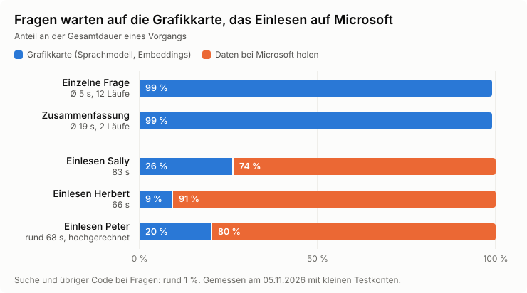

# Warum dauert was wie lange?

Gemessen am 05.11.2026 auf dem Server (RTX 2070 Super mit 8 GB VRAM, 16 GB RAM, WSL2 mit Docker), mit den Konten Peter
und Brad im Test-Tenant. Bei den Fragen waren die Modelle bereits geladen.

## Das Ergebnis

| Vorgang | Typische Dauer | Was begrenzt | Rechenleistung das Problem? |
|---|---|---|---|
| Einzelne Frage | 4–7 s | Grafikkarte: Geschwindigkeit des Sprachmodells | **Ja**, und das Modell ist durch die 8 GB VRAM begrenzt |
| Zusammenfassung | 15–24 s | Grafikkarte: lange Antwort, mehr Modellaufrufe | **Ja** |
| Mehrere Fragen gleichzeitig | bis 20–33 s bei dreien | Warteschlange, immer nur eine Anfrage je Modell | **Ja**, es gibt nur eine Grafikkarte |
| Einlesen eines Kontos | rund 1–1,5 Minuten | Antwortzeit von Microsoft | **Nein** |
| Ablage nach der Antwort | zusätzlich 2–3 s | Grafikkarte: weitere Modellaufrufe | **Ja**, aber kaum spürbar |

Bei Fragen ist also die Grafikkarte der Engpass, beim Einlesen Microsoft. Prozessor und Arbeitsspeicher waren in den
Messungen nicht der begrenzende Faktor. Mehr davon würde die Antworten deshalb voraussichtlich kaum beschleunigen.

Die Werte zum Diagramm:

| Vorgang | Dauer | Grafikkarte | Daten bei Microsoft holen |
|---|---|---|---|
| Einzelne Frage | Ø 5 s, 12 Läufe | 99 % | – |
| Zusammenfassung | Ø 19 s, 2 Läufe | 99 % | – |
| Einlesen Sally | 83 s | 26 % | 74 % |
| Einlesen Herbert | 66 s | 9 % | 91 % |
| Einlesen Peter | rund 68 s, Embeddings hochgerechnet | 20 % | 80 % |

## Eine Frage

Von der gesamten Zeit entfallen **rund 95–99 % auf das Sprachmodell**. Suche und Code brauchen meist unter 0,3 s, nur die
erste Frage eines Programmstarts lag bei 1,3 s.

| Schritt | Dauer | Anmerkung |
|---|---|---|
| Suche und übriger Code | 0,02–0,25 s | Fällt nicht ins Gewicht |
| Widerspruchsprüfung | 0,3–1,7 s | Eigener Modellaufruf, Wiederholungen kommen teils aus dem Zwischenspeicher |
| Prompt verarbeiten | 0,5–1,1 s | 1.800–2.850 Token |
| Antwort schreiben | 2,2–4,9 s | Etwa 67 Token/s, bei allen Fragen fast gleich |

Das erste Wort der Antwort erscheint 0,6–1,4 s nach dem Start dieses Schritts. Die Schreibgeschwindigkeit ist praktisch
fest, **die Dauer hängt also vor allem an der Länge der Antwort.** Eine Frage mit 150 Token war in 5 s fertig, eine mit
320 Token in 6 s und eine Zusammenfassung mit rund 650 Token in 15–24 s. Die Grafikkarte war dabei im Schnitt zu 75 %
ausgelastet.

## Mehrere Personen gleichzeitig

| Gleichzeitige Fragen | Zeit je Frage |
|---|---|
| 1 | 5,6 s |
| 2 | 6,0 s und 9,7 s |
| 3 (drei Läufe) | 5,5 / 18,5 / 24,4 s · 8,6 / 13,5 / 19,8 s · 24,9 / 29,5 / 32,7 s |

Die Fragen laufen nicht parallel, sondern warten aufeinander, weil `OLLAMA_NUM_PARALLEL=1` gesetzt ist. Das ist bewusst
so, denn die Modelle belegen zusammen schon 5,7 GB VRAM. Die Werte schwanken stark, drei Läufe erlauben nur eine grobe
Aussage.

## Das Einlesen

Gemessen wurde das Holen der Daten für Peter, dazu kommen die Zeiten aus dem Log der ersten Läufe von Sally und Herbert.

| Schritt | Dauer (Peter) | Davon Warten auf Microsoft |
|---|---|---|
| OneNote, 12 Dokumente | 22,0 s (22 Anfragen) | 22,0 s |
| Dateien, 98 Dokumente | 15,8 s (66 Anfragen) | 15,7 s |
| Teams, 61 Dokumente | 15,2 s (33 Anfragen) | 15,2 s |
| Outlook und Kalender | 0,7 s (2 Anfragen) | 0,6 s |
| **Daten holen gesamt** | **53,7 s** | **fast die gesamte Zeit** |
| Abschnitte bilden | unter 0,01 s | – |
| Embeddings, 222 Abschnitte | rund 14 s (hochgerechnet) | – |

| Erster Lauf laut Log | Daten holen | Embeddings | Gesamt |
|---|---|---|---|
| Sally, 133 Abschnitte | 61 s | 21 s | 83 s |
| Herbert, 120 Abschnitte | 59 s | 6 s | 66 s |

Am langsamsten ist **OneNote mit rund 1 s je Anfrage**. Die Anfragen laufen außerdem nacheinander. Eine schnellere
Grafikkarte würde hier wenig bringen, weil sie nur den kleineren Teil betrifft. Peters Messung nutzt für unveränderte
Dateien den Zwischenspeicher, ein allererster Lauf mit vielen Dateien kann länger dauern. Während des Einlesens konkurriert
die App mit laufenden Fragen um die Grafikkarte.

## Ungeklärt: einzelne Ausreißer

Im ersten Messlauf (18:02–18:04 Uhr UTC) dauerten einzelne Fragen viel länger, etwa **52 s statt 6 s**, bei gleich vielen
Token. In den 12 Durchläufen direkt danach trat das nicht mehr auf (4,3–6,4 s).

- **Ausgeschlossen:** Modelle neu laden, denn die Ladezeit lag bei fast 0 s. Das Kontextfenster war ebenfalls gleich.
- **Nicht belegt:** die Ursache. Ollama selbst brauchte in dieser Zeit so lange, das zeigt sein Log. Kurz zuvor wurde die
  App von Hand getestet, und vor dem Lauf zeigte der Ollama-Container rund 70 % CPU-Last. Möglich sind Nachwirkungen davon
  oder Konkurrenz durch andere Programme: Von den 8 GB VRAM waren rund 7 GB belegt, davon 5,7 GB durch die Modelle, und
  unter Windows waren nur rund 2 GB RAM frei.
- **So lässt es sich klären:** Beim nächsten Ausreißer gleichzeitig `docker compose -f server/docker-compose.yml logs
  ollama --tail 30`, `nvidia-smi` und den Task-Manager ansehen.

Wer so einen Hänger erlebt, sollte ihn also nicht als normale Antwortzeit werten.

## Was helfen würde

| Maßnahme | Hilft bei | Einschätzung |
|---|---|---|
| Kürzere Antworten | Fragen | Direkte Wirkung, weil die Länge die Dauer bestimmt. Kostet aber Details |
| Weniger Modellaufrufe | Fragen | Widerspruchsprüfung und Suchvarianten nur, wo sie nötig sind |
| Stärkere Grafikkarte | Fragen, gleichzeitige Nutzer | Wirkt am stärksten: mehr VRAM erlaubt auch größere Modelle und parallele Anfragen |
| Delta-Abfragen bei Microsoft | Einlesen | Nur Änderungen holen, bereits als Idee im Entscheidungsbaum |
| Parallele Anfragen an Microsoft | Einlesen | Möglich, aber Risiko von Drosselung (HTTP 429) |
| Mehr Prozessor oder RAM | – | Voraussichtlich kaum spürbar, außer falls die Ausreißer daran liegen |

## Grenzen dieser Messung

- Wenige Durchläufe an einem Abend, mit kleinen Testkonten (rund 220 Abschnitte). Echte Postfächer sind größer, dann wachsen
  vor allem das Einlesen und die Stichwortsuche, die pro Frage den ganzen Index durchgeht.
- Die Fragen wurden direkt im Container gestellt. Der Weg über Cloudflare und das Anzeigen im Browser kommen hinzu und sind
  nicht gemessen.
- Beim Start des Servers kommen die Modelle dazu: früher gemessen 96 s für das Nachladen, inzwischen werden sie vorab geladen.
- Die Ablage ist in drei Durchläufen gemessen. Der Anteil des Steckbriefs ist darin nicht einzeln ausgewiesen.
