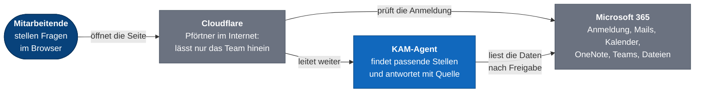
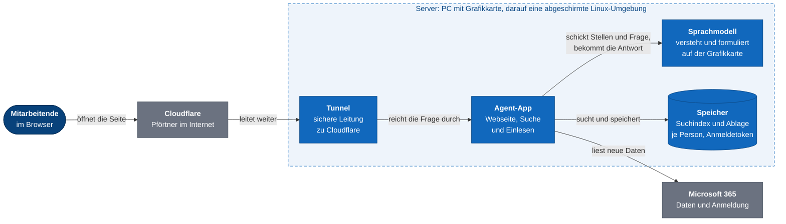

# So ist der KAM-Agent aufgebaut

Der KAM-Agent beantwortet Fragen aus den eigenen Microsoft-365-Daten, jede Aussage mit Quelle. Die beiden Bilder zeigen
den Aufbau nach dem C4-Modell: erst aus großer Entfernung, dann mit einem Blick ins Innere des Servers.

## Ebene 1: Das Gesamtbild

Wer nutzt das System, und mit welchen Diensten arbeitet es zusammen?

| Baustein | Aufgabe |
|---|---|
| **Mitarbeitende** | Stellen ihre Fragen im Browser und sehen nur die eigenen Daten. |
| **Cloudflare** | Prüft am Eingang, wer hineindarf. So ist der Server nicht offen im Internet erreichbar. |
| **KAM-Agent** | Unser System: Es sucht die passenden Textstellen und formuliert daraus die Antwort. |
| **Microsoft 365** | Bestätigt die Anmeldung und liefert die Daten. Jede Person gibt den Zugriff einmal selbst frei. |

## Ebene 2: Ein Blick in den Server

Woraus besteht der KAM-Agent? Jeder blaue Kasten ist ein eigener, abgetrennter Baustein auf dem Server.

| Baustein | Aufgabe |
|---|---|
| **Tunnel** | Baut die Verbindung von innen nach außen auf. Am Router ist deshalb kein Eingang offen. |
| **Agent-App** | Das Herzstück: zeigt die Webseite, sucht die passenden Stellen und liest neue Daten ein. |
| **Sprachmodell** | Läuft auf dem Server selbst, Fragen und Daten gehen an keinen KI-Anbieter. Aus dem Tunnel ist es nicht erreichbar. |
| **Speicher** | Hält je Person einen eigenen Suchindex und eine eigene Ablage. So bleiben die Daten getrennt. |

**Beispiel einer Frage:** Die Frage läuft über Cloudflare und den Tunnel zur Agent-App. Diese sucht im Speicher der
angemeldeten Person die passenden Stellen und gibt sie dem Sprachmodell. Die fertige Antwort geht mit Quellen zurück.
Bei Microsoft 365 wird dafür nicht nachgefragt: Die Daten liegen schon vorab eingelesen im Speicher.
